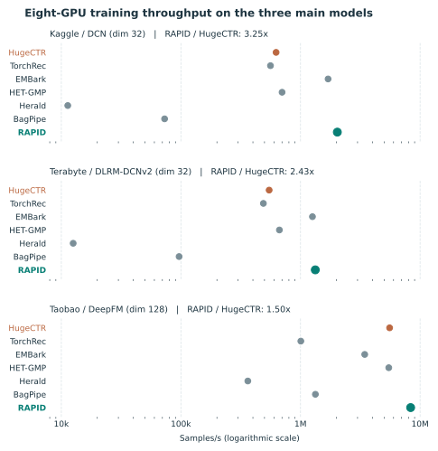
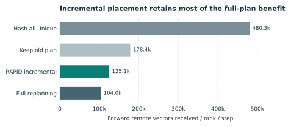
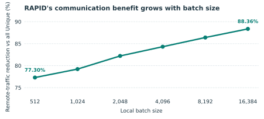

# Revision of VLDB Submission #1058

We thank the reviewers for their constructive comments. We first address the shared revision requests, then respond to each reviewer. For every substantive change, we reproduce the revised manuscript text and identify its location so that the response can be read independently of the paper.

## Experimental setting

Our new eight-GPU experiments use 32 GiB V100 GPUs, a local batch size of 8,192, shuffled inputs preloaded in memory, and 510 measured GPU training steps. The window includes online mapping, scheduling, and communication. RAPID optimizes row-wise embedding sharding, and the TorchRec comparison uses row-wise sharding. HET-GMP uses SGD 0.01 for its shared tables, apart from the marked Kaggle/DCN run; the other methods use AdaGrad 0.01. Settings specific to the T-series communication and accuracy experiments are stated below.

## Meta Revision 1: External baselines, workloads, and training results

The reviewers asked whether RAPID's gains extend beyond the original HugeCTR comparison. **They do on the measured eight-GPU workloads:** RAPID has the highest training throughput in all 12 dataset/model combinations in Table 1. The three main models retain the paper's shapes: Kaggle/DCN has 26 tables, 214 sparse features, dimension 32, six cross layers, and two 1,024-wide deep layers; Terabyte/DLRM-DCNv2 has 26 tables, 214 sparse features, dimension 32, three cross layers, a 512-dimensional projection, and a `[1024,1024,512,256,1]` top MLP; Taobao/DeepFM has four tables, dimension 128, three 400-wide deep layers, and first- and second-order FM terms. The other nine combinations use dimension-32 model extensions.

**Table 1. Measured eight-GPU training throughput (samples/s).**

| Dataset / model | HugeCTR | TorchRec | EMBark | HET-GMP | Herald | BagPipe | RAPID |
| --- | ---: | ---: | ---: | ---: | ---: | ---: | ---: |
| Kaggle / DLRM | 1,265,110 | 568,823 | 1,804,285 | 629,040 | 10,459 | 73,470 | 2,136,522 |
| Kaggle / DCN, dim32 | 625,151 | 560,969 | 1,701,025 | 701,298† | 11,319 | 73,040 | 2,032,420 |
| Kaggle / Wide&Deep | 1,251,291 | 533,137 | 1,796,028 | 775,392 | 9,848 | 70,144 | 2,292,587 |
| Kaggle / DeepFM | 1,405,858 | 556,847 | 2,111,551 | 816,947 | 9,845 | 71,503‡ | 2,855,600 |
| Terabyte / DLRM | 1,273,833 | 568,210 | 1,849,886 | 653,264 | 10,459 | 99,594 | 2,010,277 |
| Terabyte / DLRM-DCNv2, dim32 | 546,769 | 489,409 | 1,258,722 | 666,211 | 12,562 | 96,550 | 1,329,655 |
| Terabyte / Wide&Deep | 1,262,214 | 532,223 | 1,878,571 | 814,181 | 10,344 | 94,800 | 2,107,001 |
| Terabyte / DeepFM | 1,417,189 | 556,198 | 2,236,009 | 867,333 | 10,377 | 96,978‡ | 2,577,394 |
| Taobao / DLRM | 4,588,460 | 2,147,182 | 4,027,885 | 3,230,496 | 415,450 | 2,064,385 | 4,947,326 |
| Taobao / DLRM-DCNv2 | 3,306,323 | 1,802,251 | 3,002,414 | 2,379,513 | 424,153 | 1,981,837 | 3,488,199 |
| Taobao / Wide&Deep | 6,472,360 | 2,393,622 | 5,305,386 | 5,532,203 | 434,392 | 2,096,891 | 7,255,623 |
| Taobao / DeepFM, dim128 | 5,561,281 | 1,006,574 | 3,443,948 | 5,470,898 | 362,719 | 1,332,057‡ | 8,338,178 |

† HET-GMP diverged on Kaggle/DCN at SGD 0.01; the reported run uses a smaller initialization and SGD 0.001. ‡ The marked BagPipe DeepFM runs had high final loss; their throughput is reported, but they are not used for accuracy comparisons. HugeCTR uses all Reduction for the Kaggle and Terabyte main models and all Unique for the Taobao main model; RAPID uses CPS and per-table ACP. The new Herald main-model run uses cache threshold 100 and eight LAIA threads per rank.

<figure>

<figcaption>Response Figure A. Seven-method throughput on the three main models from Table 1. The horizontal scale is logarithmic; exact values and run-specific notes are in Table 1.</figcaption>
</figure>

**Manuscript revision — Sections 7.1–7.2, “Baselines,” “Models and Datasets,” and the end-to-end comparison.** The added text reads:

> We extend the system comparison to TorchRec with row-wise sharding, EMBark, HET-GMP, Herald, and BagPipe. The evaluation covers DLRM, DCN, Wide&Deep, and DeepFM on Kaggle, Terabyte, and Taobao, retaining the primary model configurations and adding dimension-32 model extensions. Inputs are shuffled and preloaded in memory; throughput measures 510 GPU training steps, including online mapping, scheduling, and communication. RAPID achieves the highest measured throughput in all 12 configurations. HET-GMP uses its native shared-table SGD update, while the other systems use AdaGrad.

The reviewers also requested workloads with substantially more tables. T180, T200, and T510 are produced by the HugeCTR synthetic-data generator using each table's vocabulary and hotness with Zipf(1.1) ID sampling; the T180 generator actually emits 177 tables. The complete official configurations could not be trained on this machine at their original dimensions: idealized FP32 embedding weights alone would require approximately 30.9, 48.4, and 53.4 GiB per GPU, before optimizer state and training buffers. We therefore compare communication on one common 65,536-sample shard per workload, preserving table structure and hotness while using dimension 32 and local batch 512. Five passes give 80 global batches. These are communication comparisons, not full-configuration throughput claims.

**Table 2. Eight-rank forward-plus-backward remote embedding payload on the T-series shards (GiB).**

| Workload | HugeCTR | TorchRec | EMBark | HET-GMP | Herald | BagPipe | RAPID |
| --- | ---: | ---: | ---: | ---: | ---: | ---: | ---: |
| T180 | 73.311 | 96.797 | 96.797 | 157.642 | 241.929 | 763.835 | 64.752 |
| T200 | 76.259 | 109.375 | 109.375 | 52.306 | 84.617 | 229.810 | 37.835 |
| T510 | 64.700 | 278.906 | 278.906 | 41.318 | 71.119 | 226.686 | 24.024 |

RAPID transfers the least payload in all three T-series comparisons. On the corresponding dimension-32 Criteo inputs, RAPID/HET-GMP payloads are 15.066/15.829 GiB for Kaggle and 10.785/11.553 GiB for Terabyte, measured over eight ranks and five passes. Taobao is an exception: HET-GMP transfers less. RAPID keeps each original global batch intact, uses both CPS and per-table ACP, enforces equal main-embedding capacity, and supports incremental placement. These distinctions extend the comparison beyond traffic reduction alone.

**Manuscript revision — Section 7.1, “Models and Datasets,” and Section 7.2, after the training comparison.** The added text reads:

> We use the HugeCTR T180, T200, and T510 generators to evaluate table-rich access patterns. At their original dimensions, the full configurations exceed the available training memory. We compare all seven methods on common shards that preserve table structure and hotness, with dimension 32 and local batch 512. RAPID has the lowest forward-plus-backward remote embedding payload on each of the three workloads.

**Manuscript revision — Section 8, after “Embedding Placement, Caching, and Replication.”** The new related-work paragraph reads:

> HET-GMP is a close graph-based predecessor to CPS: it derives embedding co-occurrence from a sample–embedding graph and jointly partitions samples and embedding rows. RAPID extends co-occurrence-aware placement by preserving every original global batch, choosing Unique or Reduction per table through ACP, balancing main-embedding capacity, and placing new IDs without moving existing rows. We compare HET-GMP, Herald, BagPipe, and other systems in both training throughput and remote embedding payload.

## Meta Revision 2: Limits of physical scalability

The reviewers correctly distinguish physical training from trace-driven scaling. **Our measured speedup claim is limited to one eight-GPU server.** The 16–128-rank results establish remote-transfer and load trends; they do not measure multi-node collective latency or end-to-end throughput. Section 7.6 already states this distinction. We narrow the abstract and conclusion to match it.

**Manuscript revision — Abstract, replace the final scalability sentence:**

> RAPID improves measured training throughput on an eight-GPU server. Trace-driven studies from 16 to 128 logical ranks show favorable embedding-transfer and load trends; physical multi-node training speedup is left for future evaluation.

**Manuscript revision — Section 9, replace the scalability conclusion:**

> RAPID's measured training gains are established on one eight-GPU server. Larger logical-rank experiments support the transfer-volume trend, while physical multi-node scalability remains to be evaluated.

## Meta Revision 3: Offline plans and incremental updates

The reviewers asked whether an offline plan remains useful as data grows. **Incremental placement retains most of the communication benefit without moving existing embedding rows.** We build an initial plan from 2,097,152 shuffled Criteo day-6 multi-hot samples, then append 56 disjoint windows of 65,536 samples. All four policies below are compared on the same final eight windows, W49–W56. The RAPID update places new IDs and schedules new samples; every previously placed row retains its owner and physical ID.

**Table 3. Mean forward remote vectors received per rank per step on W49–W56.**

| Strategy | Placement of new IDs | Vectors | Reduction vs. hash all Unique |
| --- | --- | ---: | ---: |
| Hash all Unique | Hash placement | 480,344.75 | — |
| Keep old plan | Round robin | 178,368.19 | 62.87% |
| RAPID incremental | Co-access-aware | 125,080.08 | 73.96% |
| Full replanning | Rebuild the global plan | 103,956.46 | 78.36% |

<figure>

<figcaption>Response Figure B. Mean forward remote receives on the same W49–W56 windows; lower is better.</figcaption>
</figure>

Incremental placement reduces receives by 73.96% relative to hash-placed all Unique and by 29.88% relative to keeping the old plan with round-robin new-ID placement. Full replanning sends fewer vectors, but requires rebuilding the global plan. The 480,344.75 baseline is a *one-way forward receive count* per rank per step, not a forward-plus-backward total. This experiment tests same-day data growth; it does not measure temporal distribution shift or planning wall time.

**Manuscript revision — Section 7.8, replace “Sustainability under Incremental Data Updates.”** The replacement reads:

> We build a placement plan on an initial Criteo multi-hot sample window and compare four policies on the same later, nonoverlapping windows: hash-placed all Unique, retaining the old plan, RAPID's incremental placement, and full replanning. RAPID's incremental update lowers forward remote receives by 73.96% relative to hash all Unique and by a further 29.88% relative to retaining the old plan. It places new IDs while keeping the owner and physical ID of every existing embedding row unchanged, so no old rows migrate. The experiment shows that the plan can be extended efficiently as data are appended.

## Meta Revision 4: Batch size, peak load, and planning parameters

The reviewers asked whether batch size changes deduplication opportunities and whether the busiest rank erases the average benefit. **Larger batches strengthen RAPID's communication reduction, and the measured peak receive load remains close to the mean.** We use the same 262,144 Criteo samples and eight ranks for all batch sizes and recalculate the all-Unique baseline at each size.

**Table 4. Forward remote vectors per input sample.**

| Local batch | All Unique | RAPID | RAPID reduction |
| ---: | ---: | ---: | ---: |
| 512 | 90.250 | 20.485 | 77.30% |
| 1,024 | 82.145 | 17.070 | 79.22% |
| 2,048 | 74.045 | 13.170 | 82.21% |
| 4,096 | 66.145 | 10.380 | 84.31% |
| 8,192 | 58.540 | 7.960 | 86.40% |
| 16,384 | 51.230 | 5.965 | 88.36% |

<figure>

<figcaption>Response Figure C. RAPID's forward remote-traffic reduction relative to all Unique grows with local batch size.</figcaption>
</figure>

As local batch increases from 512 to 16,384, RAPID falls from 20.485 to 5.965 vectors per sample, and its reduction relative to all Unique grows from 77.30% to 88.36%. More repeated IDs fall in the same batch and can be deduplicated. This is a transfer-count sensitivity study; batch-specific throughput, local-hit rate, and gradient accumulation have not been measured here.

The busiest rank receives 1.030–1.197 times the mean on the three real datasets. Main embedding capacity is strictly balanced: the largest and smallest rank allocations differ by at most one row.

**Table 5. Eight-rank receive load and main-embedding placement.**

| Dataset | Mean vectors/rank/step | Busiest rank/step | Receive peak/mean | Main rows/rank, min–max | Storage peak/mean |
| --- | ---: | ---: | ---: | ---: | ---: |
| Kaggle | 98,739.62 | 103,057.56 | 1.044 | 2,409,915–2,409,916 | 1.000000207 |
| Terabyte | 70,678.40 | 84,585.56 | 1.197 | 2,682,414–2,682,415 | 1.000000326 |
| Taobao | 5,829.11 | 6,003.38 | 1.030 | 120,622–120,623 | 1.000002073 |

The default planning settings are β=0.0001, γ=0.2, and hot-ID Top-K=40,000. We change one setting at a time. Reversing the profiling-batch order changes only the sequence used to collect planning statistics, not the training samples or global batches. All settings retain the equal-capacity main-embedding constraint.

**Table 6. Planning-parameter sensitivity: forward remote receives per sample.**

| Plan setting | Vectors/sample | Change from default | Main-storage peak/mean |
| --- | ---: | ---: | ---: |
| Default | 7.962 | — | 1.000000 |
| γ=0 | 11.635 | +46.1% | 1.000000 |
| β=0 | 8.097 | +1.7% | 1.000000 |
| Hot Top-K=100,000 | 8.938 | +12.3% | 1.000000 |
| Reverse profiling-batch order | 7.976 | +0.2% | 1.000000 |

**Manuscript revision — Section 5.2, after the CPS algorithm; Section 7.8, after “Load Balance.”** The added text reads:

> We use β=0.0001, γ=0.2, and hot-ID Top-K=40,000 by default. The ablations show that γ has the largest effect on communication: setting it to zero increases forward remote receives by 46.1%. Changes to β and profiling-batch order have much smaller effects. The equal-capacity placement constraint remains in effect throughout.
>
> Increasing local batch size increases within-batch deduplication and strengthens RAPID's communication reduction. Across the measured batch sizes, its reduction relative to all Unique rises from 77.30% to 88.36%. The busiest rank receives at most 1.197 times the mean on the real datasets, while the capacity constraint keeps main-embedding row counts equal across ranks to within one row.

## Meta Revision 5: Cold-ID co-occurrence and accuracy

The reviewers asked whether high cold-ID co-occurrence is an artifact of IDs seen only once or twice. **It remains frequent after excluding such IDs in the evaluated Criteo multi-hot workload.** We examine 2,097,152 samples. An ID is cold if it occurs in fewer than 0.01% of samples; its support is the number of distinct samples containing it. For each target cold ID, the maximum co-occurrence ratio (MCR) divides its largest co-occurrence count with another cold ID by its own support. A minimum target support of 100 thus retains IDs appearing 100–209 times.

**Table 7. Cold IDs with MCR>95% in the evaluated multi-hot workload.**

| Minimum target support | Eligible cold IDs | IDs with MCR>95% | Share |
| ---: | ---: | ---: | ---: |
| 10 | 1,886,103 | 1,333,054 | 70.68% |
| 20 | 953,848 | 770,892 | 80.82% |
| 50 | 353,257 | 299,515 | 84.79% |
| 100 | 129,222 | 110,490 | 85.50% |

At minimum support 100, 85.50% of eligible targets still have MCR>95%. This result concerns the evaluated multi-hot workload; the expansion can itself create co-occurrence, so we do not generalize the percentage to unexpanded categorical data.

RAPID keeps the samples in every original global batch unchanged, only assigning them to different ranks. For rank-independent sample computation and identical optimizer updates, this preserves the batch objective and aggregate gradient mathematically, subject to floating-point order. We also checked AUC in a full one-epoch Taobao/DLRM run with 23,920,640 training and 2,621,440 validation samples. Across three paired seeds, HugeCTR and RAPID achieve mean AUCs of 0.657161 and 0.657166. The mean paired difference (RAPID minus HugeCTR) is +0.000004, with a 95% confidence interval of [−0.000215, +0.000223].

The following five-seed results cover 12 further dataset/model combinations after **510 steps on 983,040 training samples**. All paired AUC-difference intervals include zero.

**Table 8. Held-out AUC and LogLoss after 510 steps.**

| Dataset / model | HugeCTR AUC | RAPID AUC | Mean paired difference [95% CI] | LogLoss, HugeCTR / RAPID |
| --- | ---: | ---: | --- | ---: |
| Kaggle / DLRM | 0.626839 | 0.625624 | −0.001216 [−0.010125, +0.007693] | 2.320256 / 2.417471 |
| Kaggle / DLRM-DCNv2 | 0.637947 | 0.640222 | +0.002275 [−0.001915, +0.006466] | 1.430427 / 1.357891 |
| Kaggle / Wide&Deep | 0.660461 | 0.659502 | −0.000959 [−0.004375, +0.002456] | 1.234775 / 1.233248 |
| Kaggle / DeepFM | 0.667539 | 0.667832 | +0.000293 [−0.000472, +0.001059] | 0.862612 / 0.862193 |
| Terabyte / DLRM | 0.589586 | 0.589612 | +0.000026 [−0.008002, +0.008054] | 0.493343 / 0.514816 |
| Terabyte / DLRM-DCNv2 | 0.600504 | 0.601417 | +0.000912 [−0.003169, +0.004993] | 0.396073 / 0.393783 |
| Terabyte / Wide&Deep | 0.601201 | 0.600938 | −0.000263 [−0.001930, +0.001405] | 0.394008 / 0.401402 |
| Terabyte / DeepFM | 0.611441 | 0.611374 | −0.000066 [−0.000578, +0.000446] | 0.248894 / 0.249281 |
| Taobao / DLRM | 0.565991 | 0.566503 | +0.000511 [−0.000519, +0.001542] | 0.689493 / 0.689298 |
| Taobao / DLRM-DCNv2 | 0.560156 | 0.560812 | +0.000656 [−0.001369, +0.002681] | 1.286928 / 1.267466 |
| Taobao / Wide&Deep | 0.568817 | 0.568714 | −0.000103 [−0.000556, +0.000349] | 1.250600 / 1.246514 |
| Taobao / DeepFM | 0.568164 | 0.568066 | −0.000099 [−0.001140, +0.000943] | 1.295433 / 1.281402 |

**Manuscript revision — Section 5.1, after Figure 6(c) and the MCR definition:**

> We repeat the cold-ID co-occurrence analysis after excluding targets with very low support. We count each ID at most once per sample and define cold IDs as those present in fewer than 0.01% of samples. High co-occurrence persists as the minimum support increases: among cold IDs observed in at least 100 samples, 85.50% have MCR>95%. Thus, the result on the evaluated Criteo multi-hot workload is not driven solely by IDs seen once or twice.

**Manuscript revision — Section 4.1, replace the accuracy-preservation claim; Section 7.3, replace the one-run accuracy discussion:**

> RAPID preserves the membership of each original global batch and changes only the rank on which its samples are processed. With the same per-sample computation and optimizer updates, the batch objective and aggregate gradient are unchanged. In a full one-epoch Taobao/DLRM comparison, the mean validation AUC is 0.657161 for HugeCTR and 0.657166 for RAPID across three paired seeds. A further five-seed comparison across 12 dataset/model combinations yields comparable held-out AUC.

## Meta Revision 6: Figure 4 and Equation (5)

Reviewer 5 identified a counting error. **Reduction sends a fixed-length aggregated output for each table; the different per-table Reduction counts in the submitted Figure 4(b) were incorrect.** The old plot counted only nonempty remote-owner contributions. We correct Figures 4(b)–(c) and the all-Reduction values in Figure 11 to the same forward remote-receive convention. With local batch B=8,192 and G=8 ranks, each table transfers B(G−1)=57,344 remote vectors per receiving rank, or 1,490,944 across 26 tables. Equation (5)'s BG=65,536 includes the B local slots; subtracting those gives transferred payload. The old approximately 567,000-vector all-Reduction total in Figure 4(c) was the nonempty-owner count, not the fixed-length result.

| Counting scope, B=8,192 and G=8 | Per table, per rank | All 26 tables |
| --- | ---: | ---: |
| Aggregated slots, including local | 65,536 | 1,703,936 |
| Forward remote vectors actually received | 57,344 | 1,490,944 |

HugeCTR's [embedding communication implementation](https://github.com/NVIDIA-Merlin/HugeCTR/blob/61b4d539aa7044e9021896f0485be1a6697f4f44/HugeCTR/embedding/operators/communication.cpp#L75-L111) exchanges the aggregated output vectors in this path.

**Manuscript revision — Section 3.2, replace Figure 4(b)–(c) and their caption; Section 6.1, immediately after Equation (5); Section 7.4, replace the Figure 4 discussion; Figure 11, correct its all-Reduction series.** The replacement text reads:

> Equation (5) includes both local and remote aggregated outputs. For actual transfer volume, Figures 4 and 11 use the B·(G−1) vectors received from other ranks. Reduction therefore transfers the same number of vectors for every table at a fixed batch size and cluster size. We correct the earlier nonempty-owner count in Figure 4 and use one consistent remote-only convention across the communication plots.

## Response to Reviewer 2

**Revision Request 1 — external baselines.** Meta Revision 1 reports the seven-system training comparison on Kaggle, Terabyte, and Taobao (Table 1), plus seven-method T-series communication results (Table 2). The revised Sections 7.1–7.2 and related-work paragraph are reproduced there.

**Revision Request 2 — physical scaling.** Meta Revision 2 gives the replacement wording in the abstract and conclusion, consistent with the existing Section 7.6: only eight-GPU speedups are physically measured; 16–128 ranks are trace-driven transfer and load studies.

**Revision Request 3 — incremental stability.** Meta Revision 3 presents the four-policy comparison on identical later windows, including zero migration of existing rows, and reproduces the revised Section 7.8 text.

**Revision Request 4 — batch size and peak load.** Meta Revision 4 gives batch-dependent transfer counts, absolute busiest-rank receives, storage balance, parameter sensitivity, and the added Sections 5.2 and 7.8 wording. The batch-size table measures traffic, not throughput or local-hit rate.

**Revision Request 5 — accuracy.** Meta Revision 5 states the precise global-batch argument, a full one-epoch three-seed Taobao comparison, and the separately labeled 510-step five-seed model checks.

## Response to Reviewer 3

**Scalability and co-occurrence support.** Meta Revisions 2 and 5 narrow the physical-scaling claim and repeat the cold-ID test at minimum supports up to 100. We revise the abstract, Section 5.1, and conclusion; Section 7.6 already gives the physical-scaling boundary. The MCR proportions describe the evaluated multi-hot workload and are not an independent-window significance test.

**Workload-aware alternatives.** Meta Revision 1 directly compares HET-GMP, Herald, and the other baselines and adds the missing HET-GMP comparison to Section 8. The text above states both the overlap with CPS and RAPID's additional global-batch, ACP, balance, and update capabilities.

**Parameters and order.** Meta Revision 4 states β, γ, and Top-K defaults and their measured sensitivity. It defines reversed profiling order and reproduces the added Section 5.2 wording. METIS seed-fraction sensitivity has not been measured.

## Response to Reviewer 5

**Detailed Evaluation 1 — HET-GMP and CPS.** The Section 8 paragraph in Meta Revision 1 acknowledges HET-GMP's graph-based co-occurrence placement directly. Tables 1–2 give measured throughput and remote embedding payload; RAPID also preserves global batches, combines CPS and ACP, and supports incremental placement. Runtime differences include the underlying HugeCTR versus Hetu/HetuTable execution paths.

**Detailed Evaluation 2 — data and hardware.** Meta Revision 1 extends the existing Taobao workload to more model and system comparisons and adds the T-series seven-method communication study. Meta Revision 2 limits physical throughput claims to the measured eight-GPU server.

**Detailed Evaluation 3 — Equation (5) and Figure 4.** Meta Revision 6 gives the corrected 57,344-vector per-table Reduction count, the 1,490,944-vector 26-table total, and the replacement text and locations for Figures 4 and 11.

**Other revisions — research challenge.** The reproduced Section 8 paragraph identifies RAPID's contribution beyond co-occurrence partitioning: preserving each global batch while combining CPS, per-table ACP, equal-capacity placement, and incremental addition of new IDs.
