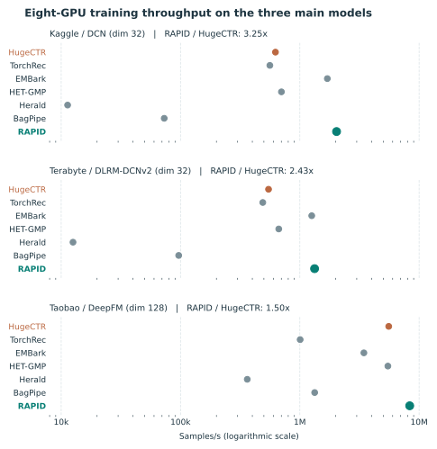
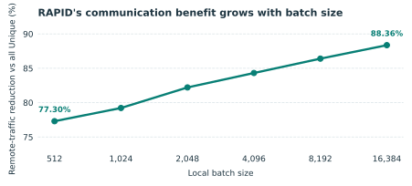
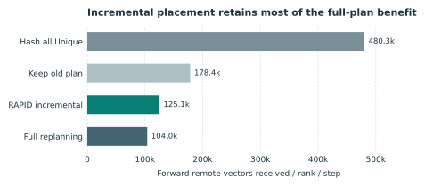

# VLDB 投稿 #1058 修订回复（英文新版的中文审阅稿）

感谢审稿人的建设性意见。我们先逐项回应 meta-review，再逐一回复各位审稿人。每项实质修改均在本回复中贴出论文修订文字并注明位置，审稿人无需翻阅论文即可看到修改内容。

## 回复 Meta-Review

**新增评估设置。**我们将 Criteo 上的实测 8 卡比较扩展到 Taobao 和四类模型，并在更多表的 T180、T200、T510 分片上增加七方法通信比较。GPU 训练使用 32 GiB V100、每卡 batch 8,192、预打乱并预载入内存的输入，以及包含在线映射、调度和通信的 510 步训练窗口。RAPID 优化 Row-wise embedding 分片，TorchRec 对照也采用 Row-wise。HET-GMP 的共享表使用 SGD 0.01，标记的 Kaggle/DCN 运行例外；其他方法使用 AdaGrad 0.01。

### 1．最接近的前人工作与负载感知基线

审稿人询问 RAPID 相比 HugeCTR 以外的系统能否保持优势。**在所测 12 个数据集／模型组合上可以：**表 1 中 RAPID 的实测训练吞吐均为最高。三组主模型沿用论文的规模：Kaggle/DCN 为 26 表、214 稀疏特征、dim32、6 层 Cross 与两层 1,024 宽 deep 层；Terabyte/DLRM-DCNv2 为 26 表、214 稀疏特征、dim32、3 层 Cross、512 维投影与 `[1024,1024,512,256,1]` 顶层 MLP；Taobao/DeepFM 为 4 表、dim128、三层 400 宽 deep 层和一阶、二阶 FM 项。其余九组为 dim32 扩展模型。

**表 1：8 卡实测训练吞吐（samples/s）。**

| 数据集／模型 | HugeCTR | TorchRec | EMBark | HET-GMP | Herald | BagPipe | RAPID |
| --- | ---: | ---: | ---: | ---: | ---: | ---: | ---: |
| Kaggle／DLRM | 1,265,110 | 568,823 | 1,804,285 | 629,040 | 10,459 | 73,470 | 2,136,522 |
| Kaggle／DCN，dim32 | 625,151 | 560,969 | 1,701,025 | 701,298† | 11,319 | 73,040 | 2,032,420 |
| Kaggle／Wide&Deep | 1,251,291 | 533,137 | 1,796,028 | 775,392 | 9,848 | 70,144 | 2,292,587 |
| Kaggle／DeepFM | 1,405,858 | 556,847 | 2,111,551 | 816,947 | 9,845 | 71,503‡ | 2,855,600 |
| Terabyte／DLRM | 1,273,833 | 568,210 | 1,849,886 | 653,264 | 10,459 | 99,594 | 2,010,277 |
| Terabyte／DLRM-DCNv2，dim32 | 546,769 | 489,409 | 1,258,722 | 666,211 | 12,562 | 96,550 | 1,329,655 |
| Terabyte／Wide&Deep | 1,262,214 | 532,223 | 1,878,571 | 814,181 | 10,344 | 94,800 | 2,107,001 |
| Terabyte／DeepFM | 1,417,189 | 556,198 | 2,236,009 | 867,333 | 10,377 | 96,978‡ | 2,577,394 |
| Taobao／DLRM | 4,588,460 | 2,147,182 | 4,027,885 | 3,230,496 | 415,450 | 2,064,385 | 4,947,326 |
| Taobao／DLRM-DCNv2 | 3,306,323 | 1,802,251 | 3,002,414 | 2,379,513 | 424,153 | 1,981,837 | 3,488,199 |
| Taobao／Wide&Deep | 6,472,360 | 2,393,622 | 5,305,386 | 5,532,203 | 434,392 | 2,096,891 | 7,255,623 |
| Taobao／DeepFM，dim128 | 5,561,281 | 1,006,574 | 3,443,948 | 5,470,898 | 362,719 | 1,332,057‡ | 8,338,178 |

† HET-GMP 在 Kaggle/DCN 上使用 SGD 0.01 时 loss 发散，该格改用更小的参数初值和 SGD 0.001。‡ 标记的 BagPipe DeepFM 运行末步 loss 偏高；报告其吞吐，但不用于精度比较。HugeCTR 在 Kaggle、Terabyte 主模型上使用全 Reduction，在 Taobao 主模型上使用全 Unique；RAPID 使用 CPS 和逐表 ACP。Herald 新补测的主模型采用缓存阈值 100、每 rank 8 个 LAIA 线程。

<figure>

<figcaption>回复图 A：表 1 中三组主模型的七方法吞吐。横轴为对数刻度；精确数值和特殊运行条件见表 1。</figcaption>
</figure>

**论文修改位置：Sections 7.1–7.2，“Baselines”“Models and Datasets”以及端到端对比。** 新增文字为：

> 我们将系统对比扩展到 Row-wise TorchRec、EMBark、HET-GMP、Herald 和 BagPipe，在 Kaggle、Terabyte、Taobao 上测量 DLRM、DCN、Wide&Deep 与 DeepFM，保留论文主模型配置，并增加统一 dim32 的扩展模型。输入预先打乱并预载入内存；吞吐统计 510 步 GPU 训练，包含在线映射、调度和通信。RAPID 在全部 12 个组合中均取得最高的实测吞吐。HET-GMP 的原生共享表使用 SGD，其他系统使用 AdaGrad。

审稿人还要求表数明显更多的负载。T180、T200、T510 来自 HugeCTR 官方合成数据生成器，按各表词表与 hotness 用 Zipf(1.1) 抽样 ID；T180 生成器实际输出 177 张表。官方完整配置在原始逐表维度下无法于本机完成训练：仅理想均分的 FP32 embedding 权重每卡约需 30.9、48.4、53.4 GiB，还未计优化器状态与训练缓冲。因此我们在每种负载的同一个 65,536 样本分片上比较通信，保留表结构与 hotness，统一 dim32、每卡 batch512。五次遍历共 80 个 global batch。这是通信对比，不是完整官方配置的吞吐结论。

**表 2：T 系列分片上 8 rank 前向加反向远端 embedding payload（GiB）。**

| 负载 | HugeCTR | TorchRec | EMBark | HET-GMP | Herald | BagPipe | RAPID |
| --- | ---: | ---: | ---: | ---: | ---: | ---: | ---: |
| T180 | 73.311 | 96.797 | 96.797 | 157.642 | 241.929 | 763.835 | 64.752 |
| T200 | 76.259 | 109.375 | 109.375 | 52.306 | 84.617 | 229.810 | 37.835 |
| T510 | 64.700 | 278.906 | 278.906 | 41.318 | 71.119 | 226.686 | 24.024 |

RAPID 在三个 T 系列分片上的传输量均最少。相应 dim32 Criteo 输入上，RAPID／HET-GMP 的 payload 在 Kaggle 为 15.066／15.829 GiB，Terabyte 为 10.785／11.553 GiB；范围为 8 rank、五次遍历。Taobao 是例外，由 HET-GMP 传输得更少。RAPID 保持每个原始 global batch 的样本集合，结合 CPS 与逐表 ACP，等量约束主 embedding 容量，并支持增量放置；这些区别不只体现在通信数字上。

**论文修改位置：Section 7.1 的“Models and Datasets”，以及 Section 7.2 的训练对比之后。** 新增文字为：

> 我们使用 HugeCTR 的 T180、T200、T510 生成器测试更多表的访问模式。原始维度下的完整配置超过了可用训练显存，因此在保留表结构与 hotness 的共同分片上比较七种方法，统一 dim32、每卡 batch512。RAPID 在三个负载上的前向加反向远端 embedding 传输量均最低。

**论文修改位置：Section 8，“Embedding Placement, Caching, and Replication”之后。** 新增相关工作段落为：

> HET-GMP 是 CPS 接近的图划分前人工作：它根据样本与 embedding 二部图推导共现关系，并联合划分样本与 embedding 行。Embedding Scheduling 也使用位置感知的输入分配器来决定样本在哪个设备训练。RAPID 在这些放置与调度思路上进一步保持每个原始 global batch 不变，通过 ACP 逐表选择 Unique 或 Reduction，均衡主 embedding 容量，并且无需移动旧行即可放置新 ID。我们从训练吞吐和远端 embedding 传输量两方面比较 HET-GMP、Herald、BagPipe 等系统。

### 2．加强实验评估

#### 2(a)．8 卡实测与访问记录回放

审稿人正确地区分了物理训练与访问记录扩展实验。**我们的实测加速结论仅限单机 8 卡。**16–128 rank 结果说明远端传输量和负载趋势，不能测量多机 collective 延迟或端到端吞吐。论文 Section 7.6 已说明这个边界；我们只让摘要和结论与之保持一致。

**论文修改位置：摘要，替换最后一句扩展性表述：**

> RAPID 在单机 8 卡上提高了实测训练吞吐。16–128 个逻辑 rank 的访问记录回放显示有利的 embedding 传输量和负载趋势；多机物理训练加速留待后续评估。

**论文修改位置：Section 9，替换扩展性结论：**

> RAPID 的实测训练收益建立在单机 8 卡上。更多逻辑 rank 的实验支持传输量趋势，物理多机扩展性仍待评估。

#### 2(b)．扩大负载覆盖

审稿人要求扩展到两个 Criteo 变体之外。第 1 点的 8 卡实测加入了 Taobao 和四类模型（表 1）；T180、T200、T510 分片补充了更多表的通信负载（表 2）。T 系列表统计 payload，不代表官方完整配置的训练吞吐。

#### 2(c)．CPS 参数、batch size 与顺序

审稿人询问 batch size 是否改变去重机会，以及最忙 rank 是否抵消平均收益。**更大的 batch 增强 RAPID 的通信收益；所测最忙 rank 的接收量也仍接近均值。**所有 batch 档位使用相同的 262,144 条 Criteo 样本和 8 rank，并在每档重新计算全 Unique 基线。

**表 3：每样本前向远端接收向量数。**

| 每卡 batch | 全 Unique | RAPID | RAPID 减少 |
| ---: | ---: | ---: | ---: |
| 512 | 90.250 | 20.485 | 77.30% |
| 1,024 | 82.145 | 17.070 | 79.22% |
| 2,048 | 74.045 | 13.170 | 82.21% |
| 4,096 | 66.145 | 10.380 | 84.31% |
| 8,192 | 58.540 | 7.960 | 86.40% |
| 16,384 | 51.230 | 5.965 | 88.36% |

<figure>

<figcaption>回复图 B：每卡 batch 增大时，RAPID 相对全 Unique 的前向远端通信减少比例继续提高。</figcaption>
</figure>

每卡 batch 从 512 增至 16,384，RAPID 每样本向量数从 20.485 降至 5.965，相对全 Unique 的减少比例从 77.30% 升至 88.36%。更多重复 ID 落入同一个 batch，因而可以去重。此处只测传输计数，尚未测各档吞吐、本地命中率或梯度累积效果。

三个真实数据上，最忙 rank 的接收量为平均值的 1.030–1.197 倍。主 embedding 容量严格均衡：最多与最少的 rank 只差一行。

**表 4：8 rank 的接收负载与主 embedding 放置。**

| 数据集 | 平均每 rank／步向量 | 最忙 rank／步 | 接收峰均比 | 主 embedding 行数／rank，最少–最多 | 存储峰均比 |
| --- | ---: | ---: | ---: | ---: | ---: |
| Kaggle | 98,739.62 | 103,057.56 | 1.044 | 2,409,915–2,409,916 | 1.000000207 |
| Terabyte | 70,678.40 | 84,585.56 | 1.197 | 2,682,414–2,682,415 | 1.000000326 |
| Taobao | 5,829.11 | 6,003.38 | 1.030 | 120,622–120,623 | 1.000002073 |

规划默认 β=0.0001、γ=0.2、hot-ID Top-K=40,000，每次只改一项。profiling 批次逆序只改变建立规划统计时的处理顺序，不改变训练样本或 global batch。所有设置都保留主 embedding 等量容量约束。

**表 5：规划参数对每样本前向远端接收量的影响。**

| 规划设置 | 向量／样本 | 相对默认变化 | 主存储峰均比 |
| --- | ---: | ---: | ---: |
| 默认 | 7.962 | — | 1.000000 |
| γ=0 | 11.635 | +46.1% | 1.000000 |
| β=0 | 8.097 | +1.7% | 1.000000 |
| hot Top-K=100,000 | 8.938 | +12.3% | 1.000000 |
| profiling 批次逆序 | 7.976 | +0.2% | 1.000000 |

**论文修改位置：Section 5.2 的 CPS 算法之后；Section 7.8 的“Load Balance”之后。** 新增文字为：

> 默认使用 β=0.0001、γ=0.2、hot-ID Top-K=40,000。消融结果显示 γ 对通信影响最大：设为零时，前向远端接收量增加 46.1%。改变 β 或 profiling batch 的处理顺序影响较小。所有设置都实施相同的等量容量约束。
>
> 增大每卡 batch 会增加批内去重机会，强化 RAPID 的通信收益。在所测 batch 档位，其相对全 Unique 的通信减少比例由 77.30% 升至 88.36%。真实数据上最忙 rank 的接收量最多为均值的 1.197 倍；容量约束使各 rank 的主 embedding 行数最多相差一行。

#### 2(d)．离线计划稳健性与更新开销

审稿人询问数据增长后离线计划是否仍有效，以及更新是否需要重映射旧 embedding。**RAPID 不迁移任何旧行：增量更新固定每个旧 ID 的 GPU owner 和 physical ID，只给新 ID 分配位置并调度新样本。**因此旧 embedding 权重及优化器状态留在原处，同时仍保留接近全量重算的通信收益。我们先从 2,097,152 条打乱的 Criteo day-6 multi-hot 样本建立初始计划，再添加 56 个互不重叠、各 65,536 条样本的窗口。下表四种方案均在同一批末八窗口 W49–W56 上比较。

**表 6：W49–W56 平均每 rank、每步的前向远端接收向量。**

| 策略 | 新 ID 放置方式 | 向量数 | 相对哈希全 Unique 减少 |
| --- | --- | ---: | ---: |
| 哈希全 Unique | 哈希放置 | 480,344.75 | — |
| 保留旧计划 | 轮流放置 | 178,368.19 | 62.87% |
| RAPID 增量更新 | 共现感知 | 125,080.08 | 73.96% |
| 全量重算 | 重做全局计划 | 103,956.46 | 78.36% |

<figure>

<figcaption>回复图 C：同一批 W49–W56 窗口上的平均前向远端接收量，越低越好。</figcaption>
</figure>

相对哈希全 Unique，增量放置减少 73.96% 的前向远端接收量，全量重算减少 78.36%，只相差 4.40 个百分点。全量重算需要同时迁移旧 embedding 权重和优化器状态；跨日期配对检查中，全量重算改变了 137,519 个旧行的 GPU owner，RAPID 增量更新则没有迁移旧行。

**论文修改位置：Section 7.8，替换“Sustainability under Incremental Data Updates”。** 替换文字为：

> 我们先用 Criteo multi-hot 的初始样本窗口建放置计划，再在同一批互不重叠的后续窗口上比较哈希全 Unique、保留旧计划、RAPID 增量放置与全量重算。RAPID 增量更新只为新 ID 分配位置，已有行的 GPU owner 与 physical ID 保持不变，因此无需迁移旧 embedding 权重和优化器状态。其前向远端接收量相对哈希全 Unique 减少 73.96%，相对保留旧计划进一步减少 29.88%，接近全量重算减少 78.36% 的效果；全量重算则需要迁移旧行。

### 3．文字、图表和结论的一致性

#### 冷 ID 与精度表述

审稿人询问高共现比是否仅由只出现一两次的 ID 造成。**在所测 Criteo multi-hot 负载中，排除这些 ID 后，高共现比仍普遍存在。**我们检查 2,097,152 条样本。出现在不到 0.01% 样本中的 ID 为冷 ID；支持次数是包含它的不同样本数。目标冷 ID 的最大共现比 MCR 等于它与任一其他冷 ID 的最大共同出现次数除以目标的支持次数。目标最低支持次数为 100 时，保留的目标出现 100–209 次。

**表 7：所测 multi-hot 负载中 MCR>95% 的冷 ID。**

| 目标最低支持次数 | 合格冷 ID 数 | MCR>95% 的 ID 数 | 比例 |
| ---: | ---: | ---: | ---: |
| 10 | 1,886,103 | 1,333,054 | 70.68% |
| 20 | 953,848 | 770,892 | 80.82% |
| 50 | 353,257 | 299,515 | 84.79% |
| 100 | 129,222 | 110,490 | 85.50% |

最低支持次数为 100 时，仍有 85.50% 的合格目标 MCR>95%。这个比例针对所测 multi-hot 负载；扩展过程本身可能形成共现，因此不将它推广到未经扩展的类别数据。

RAPID 保持每个原始 global batch 的样本集合不变，只改变样本分配到的 rank。在样本计算与 rank 无关且优化器更新相同的条件下，batch 目标与聚合梯度在数学上不变，浮点归约顺序除外。我们也做了完整 Taobao/DLRM 一轮训练：训练 23,920,640 条、验证 2,621,440 条。三个配对种子下，HugeCTR 和 RAPID 平均 AUC 分别为 0.657161、0.657166；配对平均差（RAPID 减 HugeCTR）为 +0.000004，95% 置信区间为 [−0.000215, +0.000223]。

下表还覆盖另外 12 个数据集／模型组合，使用 **983,040 条训练样本上的 510 步训练**和五个配对种子。全部 AUC 配对差区间包含零。

**表 8：510 步后的留出 AUC 与 LogLoss。**

| 数据集／模型 | HugeCTR AUC | RAPID AUC | 平均配对差 [95% 区间] | LogLoss，HugeCTR／RAPID |
| --- | ---: | ---: | --- | ---: |
| Kaggle／DLRM | 0.626839 | 0.625624 | −0.001216 [−0.010125, +0.007693] | 2.320256 / 2.417471 |
| Kaggle／DLRM-DCNv2 | 0.637947 | 0.640222 | +0.002275 [−0.001915, +0.006466] | 1.430427 / 1.357891 |
| Kaggle／Wide&Deep | 0.660461 | 0.659502 | −0.000959 [−0.004375, +0.002456] | 1.234775 / 1.233248 |
| Kaggle／DeepFM | 0.667539 | 0.667832 | +0.000293 [−0.000472, +0.001059] | 0.862612 / 0.862193 |
| Terabyte／DLRM | 0.589586 | 0.589612 | +0.000026 [−0.008002, +0.008054] | 0.493343 / 0.514816 |
| Terabyte／DLRM-DCNv2 | 0.600504 | 0.601417 | +0.000912 [−0.003169, +0.004993] | 0.396073 / 0.393783 |
| Terabyte／Wide&Deep | 0.601201 | 0.600938 | −0.000263 [−0.001930, +0.001405] | 0.394008 / 0.401402 |
| Terabyte／DeepFM | 0.611441 | 0.611374 | −0.000066 [−0.000578, +0.000446] | 0.248894 / 0.249281 |
| Taobao／DLRM | 0.565991 | 0.566503 | +0.000511 [−0.000519, +0.001542] | 0.689493 / 0.689298 |
| Taobao／DLRM-DCNv2 | 0.560156 | 0.560812 | +0.000656 [−0.001369, +0.002681] | 1.286928 / 1.267466 |
| Taobao／Wide&Deep | 0.568817 | 0.568714 | −0.000103 [−0.000556, +0.000349] | 1.250600 / 1.246514 |
| Taobao／DeepFM | 0.568164 | 0.568066 | −0.000099 [−0.001140, +0.000943] | 1.295433 / 1.281402 |

**论文修改位置：Section 5.1，Figure 6(c) 和 MCR 定义之后：**

> 我们排除支持次数过低的目标后，重新统计冷 ID 共现。同一 ID 在同一样本内只计一次；出现在少于 0.01% 样本中的 ID 定义为冷 ID。提高目标最低支持次数后，高共现比例仍然保持：在至少出现 100 次的冷 ID 中，85.50% 的 MCR 大于 95%。因此，所测 Criteo multi-hot 负载中的结果并非只由出现一两次的 ID 造成。

**论文修改位置：Section 4.1，替换精度保持的限定表述；Section 7.3，替换单次运行的精度讨论：**

> RAPID 保持每个原始 global batch 的成员不变，只改变样本在哪个 rank 处理。在每样本计算和优化器更新一致的条件下，batch 目标及聚合梯度保持不变。完整 Taobao/DLRM 一轮训练中，三个配对种子得到 HugeCTR 和 RAPID 的平均验证 AUC 为 0.657161、0.657166。另在 12 个数据集／模型组合上进行五种子对比，各组留出 AUC 与基线相近。

#### Figure 4 与公式 (5)

Reviewer 5 指出的计数错误成立。**Reduction 对每表传输定长聚合输出；投稿 Figure 4(b) 中不同表的 Reduction 数量不应不同。**旧图只累计非空远端 owner 的贡献。我们将 Figure 4(b)–(c) 和 Figure 11 的全 Reduction 值统一为前向远端接收口径。每卡 batch B=8,192、G=8 rank 时，每表每接收 rank 的远端传输是 B(G−1)=57,344 个向量，26 表共 1,490,944 个。公式 (5) 的 BG=65,536 包含 B 个本地位置；扣除它们才是传输 payload。旧 Figure 4(c) 的约 567,000 个向量是非空 owner 计数，而非定长 Reduction 结果。

| 统计口径，B=8,192、G=8 | 每表每 rank | 26 表 |
| --- | ---: | ---: |
| 全部聚合项，含本地 | 65,536 | 1,703,936 |
| 前向从其他 rank 接收向量 | 57,344 | 1,490,944 |

HugeCTR 的[embedding 通信实现](https://github.com/NVIDIA-Merlin/HugeCTR/blob/61b4d539aa7044e9021896f0485be1a6697f4f44/HugeCTR/embedding/operators/communication.cpp#L75-L111)在此路径交换聚合后的输出向量。

**论文修改位置：Section 3.2，替换 Figure 4(b)–(c) 和图注；Section 6.1，公式 (5) 之后；Section 7.4，替换 Figure 4 讨论；Figure 11，修正全 Reduction 曲线。** 替换文字为：

> 公式 (5) 包含本地与远端的聚合输出。比较实际传输量时，Figures 4 和 11 统一只统计从其他 rank 接收的 B·(G−1) 个向量。因此在固定 batch 和 rank 数下，每张表的 Reduction 传输向量数相同。我们修正 Figure 4 中旧的非空 owner 计数，使通信图统一采用仅远端口径。

## 回复 Reviewer 2

您要求更强的基线、明确物理扩展性的边界、检验离线计划的寿命，以及补充 batch、峰值负载和精度证据。我们依次回应，并将实验结果与论文修改文字列在前文。

**R1，外部基线。**我们在 Kaggle、Terabyte、Taobao 上实测七系统，并在相同 T 系列分片上比较通信。RAPID 在全部 12 组训练配置中吞吐最高，T 系列 payload 最低。表 1–2、回复图 A 及前文 Sections 7.1–7.2、8 修改文字给出证据。

**R2，物理扩展。**我们同意传输量回放不能测得多机训练耗时，因此将实测加速限定为 8 卡，并将 16–128 rank 结果明确写为传输量和负载研究。Meta-Review 第 2(a) 点贴出摘要与结论的替换文字。

**R3，时间稳健性。**我们在相同后续窗口比较四种策略，包括增量路径。增量放置平均每 rank 每步接收 125,080.08 个远端向量，旧行迁移为零（表 6、回复图 C）。全量重算接收 103,956.46 个向量，但需要迁移旧 embedding 权重和优化器状态；跨日期检查也确认增量路径无需迁移旧行。Meta-Review 第 2(d) 点贴出 Section 7.8 的修订文字。

**R4，batch 与峰值。**我们将每卡 batch 从 512 改到 16,384，并报告最忙 rank 的绝对接收量与主 embedding 行数。RAPID 每样本接收量的减少比例从 77.30% 升至 88.36%；最忙 rank 的接收量至多为均值的 1.197 倍，行数相差至多一行。表 3–5 与回复图 B 给出数据；batch 消融统计传输量，未测各档吞吐或本地命中率。

**R5，精度。**我们在明确执行假设后给出 global batch 不变的论证，并补充完整一轮、三组配对种子的 Taobao/DLRM 实验。HugeCTR 与 RAPID 的平均 AUC 分别为 0.657161、0.657166；另有 12 组数据／模型组合的五种子、510 步检查。Meta-Review 第 3 点和表 8 给出设置、数据及 Sections 4.1、7.3 修改文字。

## 回复 Reviewer 3

您关注物理扩展、冷 ID 共现、负载感知方法，以及 CPS 参数与顺序。前文给出各项实测范围和新增结果。

**W1/D1，扩展性。**只有 8 卡吞吐是物理训练实测。我们据此收紧摘要和结论；16–128 rank 仍为访问记录上的传输量与负载研究（Meta-Review 第 2(a) 点）。

**W2/D2，冷 ID 共现。**为检查极低频 ID 是否主导结论，我们将目标 ID 的最低支持次数提高到 100 条不同样本。129,222 个合格冷 ID 中仍有 85.50% 的 MCR>95%（表 7）。这是所测 multi-hot 负载上的稳健性检查，不是跨独立时间窗口的显著性检验；Meta-Review 第 3 点贴出 Section 5.1 新增文字。

**W3，负载感知方法。**我们在实测训练与 T 系列通信实验中比较 HET-GMP、EMBark、Herald、BagPipe 等系统（表 1–2）。Section 8 的修订段落明确承认 HET-GMP 的共现放置，并说明 RAPID 在 global batch、ACP、均衡和增量放置上的区别（Meta-Review 第 1 点）。

**W4，参数与顺序。**我们写明 β、γ、Top-K 默认值并分别改变参数；γ=0 使前向远端接收量增加 46.1%，倒转 profiling batch 顺序只改变 0.2%。表 5 和 Section 5.2 修改文字给出结果。METIS seed 比例的敏感性尚未实测。

## 回复 Reviewer 5

您指出 HET-GMP、Embedding Scheduling 与本文最接近，要求扩展数据和硬件证据，并发现 Reduction 图表计数矛盾。以下逐项回应。

**D1，HET-GMP 与 CPS。**Section 8 的新增段落承认 HET-GMP 基于共现图的放置。RAPID 进一步保持每个 global batch、逐表选择 Unique 或 Reduction、均衡主 embedding 容量并支持增量放置。表 1–2 给出系统吞吐与远端 payload；吞吐差异也包含 HugeCTR 与 Hetu／HetuTable 的执行路径差异（Meta-Review 第 1 点）。

**D2，数据与硬件。**Kaggle 与 Terabyte 同属 Criteo 结构，因此我们把 8 卡实测扩展到 Taobao 与四类模型，并加入 T180/T200/T510 的七方法通信比较。表 1 是训练吞吐；表 2 是 T 系列 payload，不是完整配置运行时间。物理吞吐结论仍限定于单机 8 卡（Meta-Review 的第 1 点和 2(a)）。

**D3，公式 (5) 与 Figure 4。**旧图中各表 Reduction 数量不同是计数错误。每卡 batch 8,192、8 rank 时，每表每接收 rank 的正确前向远端计数为 57,344 个向量，26 表合计 1,490,944。Meta-Review 第 3 点给出计算、HugeCTR 实现引用和 Figures 4、11 的修订位置与替换文字。

**Other revisions，研究挑战。** 前文贴出的 Section 8 段落说明 RAPID 在共现放置之外，还保持每个 global batch，并结合 CPS、逐表 ACP、等量容量放置和新 ID 增量更新。
